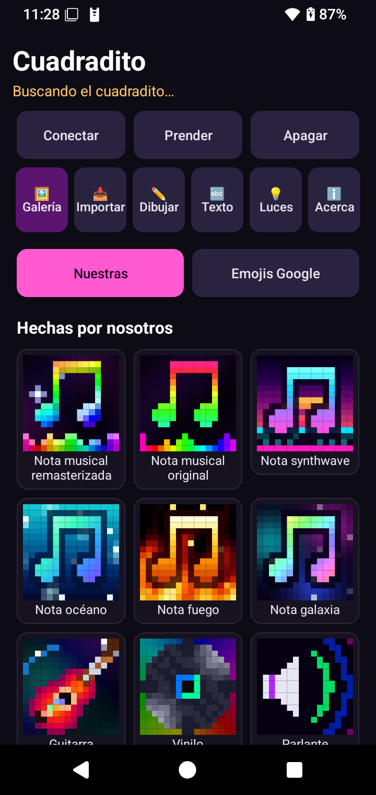
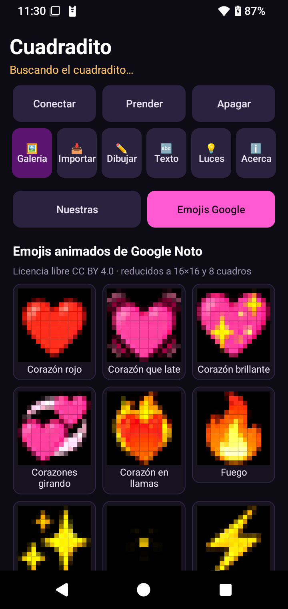
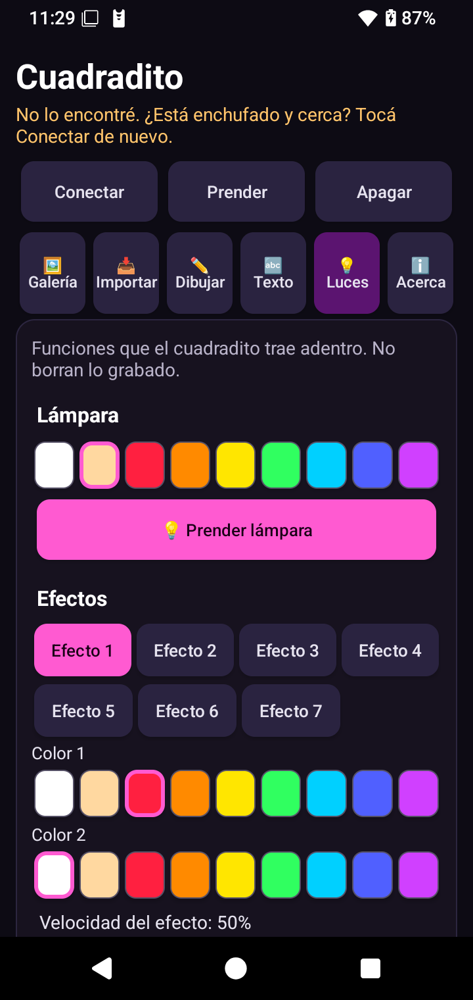

<h1 align="center">Cuadradito</h1>

<h2 align="center"><a href="https://github.com/matcarfer/Cuadradito/releases/download/v2.3/Cuadradito-2.3.apk">⬇ Download APK</a></h2>

  <a href="README.md">Español</a> · <b>English</b>  
Animations, emojis, photos, drawings and text on the MI Matrix Display LED square (16×16). 
Over Bluetooth, no internet and no accounts. App in Spanish. 
<b>Compatible with Android 5 to 16.</b>

  
  
  

**What you need:** the **MI Matrix Display** (Merkury MI-LNL62-999W). The app finds it and connects by itself.

  <a href="https://cafecito.app/matcarfer">☕ Cafecito</a> · <a href="https://ko-fi.com/matcarfer">☕ Ko-fi</a> · <a href="https://www.patreon.com/matcarfer">❤ Patreon</a> 
  <a href="https://github.com/matcarfer/library/blob/main/README.en.md">📚 Software library</a>

---

Free, closed source. Do not redistribute: share this link. No warranty. <a href="LICENSE.en">License</a> · <a href="PRIVACY.md">Privacy</a> · <a href="https://www.virustotal.com/gui/file/86475f4c03b51b21be5a3f3cc447a012cef1d959dd3878747a6192606e268492">VirusTotal</a>
