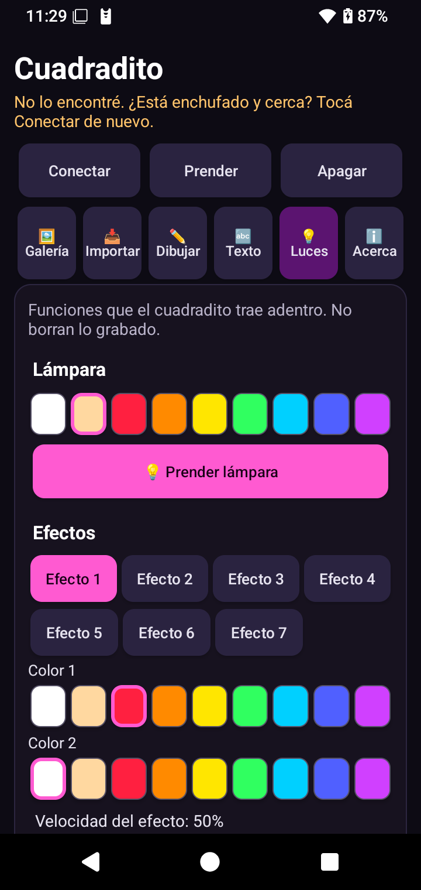

<h1 align="center">Cuadradito</h1>

<h2 align="center"><a href="https://github.com/matcarfer/Cuadradito/releases/download/v2.4/Cuadradito-2.4.apk">⬇ Descargar APK</a></h2>

  <b>Español</b> · <a href="README.en.md">English</a>  
Animaciones, emojis, fotos, dibujos y texto en el cuadrado LED MI Matrix Display (16×16). 
Por Bluetooth, sin internet y sin cuentas. 
<b>Compatible con Android 5 a 16.</b>

  
  
  

**Qué necesitás:** el **MI Matrix Display** (Merkury MI-LNL62-999W). La app lo busca y se conecta sola.

  <a href="https://cafecito.app/matcarfer">☕ Cafecito</a> · <a href="https://ko-fi.com/matcarfer">☕ Ko-fi</a> · <a href="https://www.patreon.com/matcarfer">❤ Patreon</a> 
  <a href="https://github.com/matcarfer/biblioteca">📚 Biblioteca de software</a>

---

Gratis, de código cerrado. No redistribuir: compartí este link. Sin garantía. <a href="LICENSE">Licencia</a> · <a href="PRIVACY.es.md">Privacidad</a> · <a href="https://www.virustotal.com/gui/file/3338a6ed64009da80649a4d6f572cde9734c8541b757b051b7cf6eb28ae5f0ae">VirusTotal</a>
